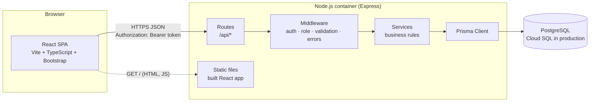
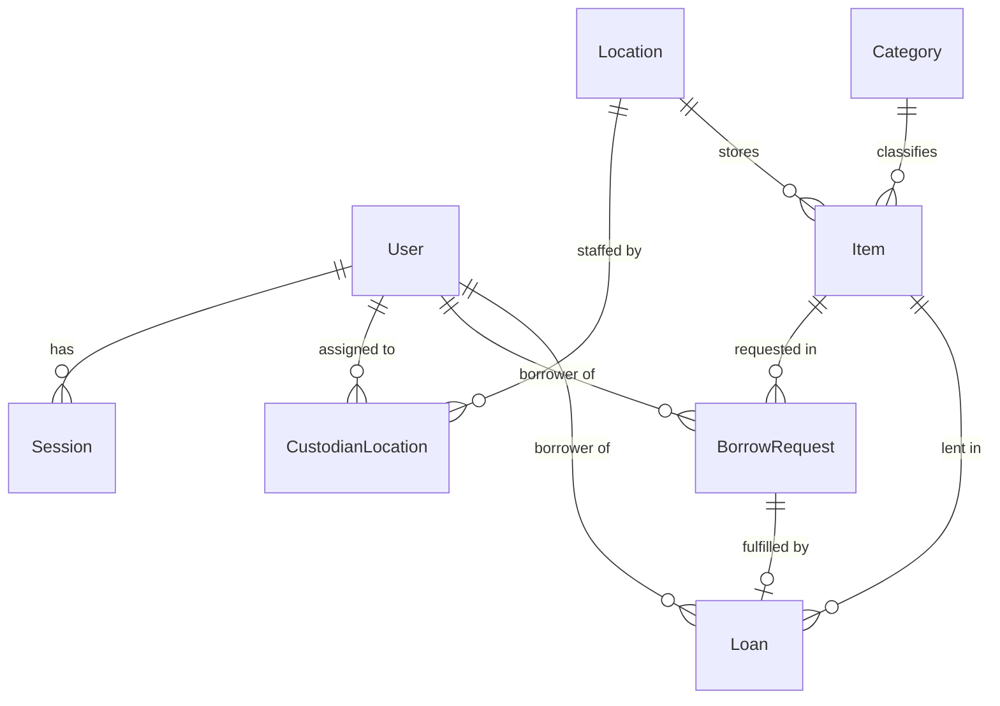
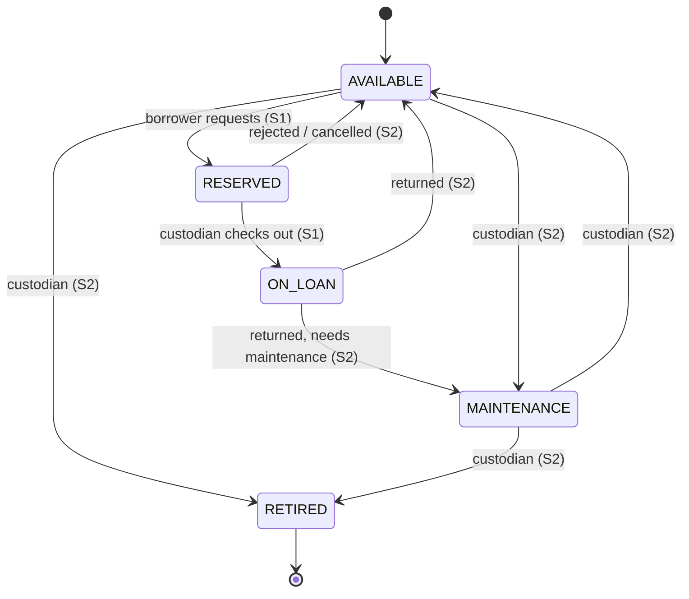

# LendLab — System-Level Software Design Specification (SDS)

Version v0.1 — 2026-11-05. Implements the baseline in [srs.md](srs.md) and [features.md](features.md). Detailed endpoints, screens, and tests for each feature are in the feature contracts under [sprints/](sprints/).

### Version history

| Version | Date | Change |
|---|---|---|
| v0.1 | 2026-11-05 | First baseline: architecture, data model, UI/API conventions, role matrix, auth, configuration, deployment plan |

---

## 1. Architecture

LendLab is a **modular monolith** with three logical layers. In production, the built React app is served by the Express server, so the whole application runs as **one container** that talks to an external PostgreSQL database.



| Layer | Responsibility | Where business rules live |
|---|---|---|
| **UI** (React) | Screens, navigation, form validation for fast feedback, showing loading/empty/error states. Holds the session token in `sessionStorage`. | **Nowhere authoritative.** UI checks are convenience only; hiding a button is never the security control. |
| **API / application** (Express) | Routes → middleware (authenticate, require role, validate input with Zod) → **service layer** that enforces BR-01…BR-14 inside database transactions. | **Service layer** (`server/src/services/*`). Each rule has a unit- or integration-tested function. |
| **Database** (PostgreSQL via Prisma) | Durable storage; foreign keys; unique constraints; **partial unique indexes** as the last line of defence for exclusivity (BR-02, BR-03). | Constraints back up the service layer under concurrency (NFR-05). |

### Technology stack

| Concern | Choice | Reason |
|---|---|---|
| Frontend | React 18 + TypeScript + Vite + Bootstrap 5, React Router | Same as Labs 1–4; fast to build. |
| Backend | Node.js 24 + Express + TypeScript | Same as Labs 1–4; matches the Lab 5 Starter Kit. |
| Validation | Zod | One schema per request body; produces field-level error details. |
| ORM / DB | Prisma 5 + PostgreSQL 16 | Typed queries, versioned migrations, seed script. |
| Password hashing | bcrypt (cost 10) | NFR-01. |
| Tests | Vitest (unit), Vitest + Supertest against a real test database (API/integration), React Testing Library (components), Playwright (E2E) | Same as Labs 1–4. |
| Delivery (Lab 5) | Docker, GitHub Actions, Artifact Registry, Cloud Run, Cloud SQL, Secret Manager | Course reference stack. |

### Repository structure

```
lendlab/
├── client/                 React app (src/pages, src/components, src/api, e2e/)
├── server/
│   ├── prisma/             schema.prisma, migrations/, seed.ts
│   ├── src/
│   │   ├── app.ts          Express app (no listen) — imported by tests
│   │   ├── index.ts        starts the server
│   │   ├── config.ts       reads and validates environment variables
│   │   ├── middleware/     authenticate.ts, requireRole.ts, validate.ts, errorHandler.ts
│   │   ├── routes/         auth.ts, items.ts, requests.ts, custodian.ts, health.ts
│   │   ├── services/       authService.ts, itemService.ts, requestService.ts, checkoutService.ts
│   │   └── lib/            password.ts, token.ts, dates.ts, errors.ts
│   └── tests/              unit/, api/
├── docs/                   srs.md, features.md, traceability.md, system-sds.md, sprints/
└── README.md               setup, commands, demo sequence
```

## 2. Data model



| Entity | Key fields | Constraints and notes |
|---|---|---|
| **User** | `id`, `email`, `name`, `passwordHash`, `role` (`BORROWER` \| `CUSTODIAN`), `isActive`, `createdAt` | `email` unique (stored lower-case). `passwordHash` never leaves the service layer. |
| **Session** | `id`, `tokenHash`, `userId`, `createdAt`, `expiresAt`, `revokedAt?` | `tokenHash` unique (SHA-256 of the raw token). Valid when `revokedAt` is null and `expiresAt > now`. |
| **Location** | `id`, `code`, `name` | `code` unique (e.g. `HW-LAB`, `MEDIA`). |
| **CustodianLocation** | `userId`, `locationId` | Composite primary key. Only users with role `CUSTODIAN` are assigned. |
| **Category** | `id`, `name` | `name` unique. |
| **Item** | `id`, `assetTag`, `name`, `description?`, `categoryId`, `locationId`, `status`, `createdAt`, `updatedAt` | `assetTag` unique. `status` ∈ `AVAILABLE`, `RESERVED`, `ON_LOAN`, `MAINTENANCE`, `RETIRED`. |
| **BorrowRequest** | `id`, `itemId`, `borrowerId`, `purpose`, `requestedDays`, `status`, `decidedById?`, `decidedAt?`, `decisionNote?`, `createdAt` | `status` ∈ `PENDING`, `FULFILLED`, `REJECTED`, `CANCELLED`. `requestedDays` 1–14 (CHECK constraint). **Partial unique index:** one `PENDING` request per `itemId`. |
| **Loan** | `id`, `requestId`, `itemId`, `borrowerId`, `checkedOutById`, `checkedOutAt`, `dueAt`, `status`, `returnedAt?`, `returnedById?` | `requestId` unique (a request is fulfilled at most once). `status` ∈ `ACTIVE`, `RETURNED`. **Partial unique index:** one `ACTIVE` loan per `itemId`. |

**Item status state machine**



**Migrations and seed.** The schema changes only through Prisma migrations committed in `server/prisma/migrations/`. Partial unique indexes and the CHECK constraint are added in a hand-edited SQL migration because Prisma's schema language cannot express them. Migrations are **additive only** (new tables/columns), so an older image still works after a rollback in Lab 5.

The seed (`npm run db:seed`) is idempotent (upserts by unique keys) and creates:

| Data | Values |
|---|---|
| Locations | `HW-LAB` CPE Hardware Lab, `MEDIA` CPE Media Room |
| Categories | Laptop, Microcontroller Kit, Camera, Projector |
| Items | 10 items across both locations (e.g. `LAP-001`…`LAP-003`, `ARD-001`…`ARD-003` in HW-LAB; `CAM-001`, `CAM-002`, `PRJ-001`, `PRJ-002` in MEDIA), `ARD-003` seeded in `MAINTENANCE` for the rejection demo |
| Users | `borrower1@lendlab.test`, `borrower2@lendlab.test` (Borrower); `custodian.hw@lendlab.test` (Custodian of HW-LAB); `custodian.media@lendlab.test` (Custodian of MEDIA) |
| Passwords | Read from `DEMO_USER_PASSWORD`. The seed **stops with an error** if the variable is missing. No password is written in code. |

## 3. UI structure and conventions

### Screens and navigation

| Route | Role | Screen | Feature |
|---|---|---|---|
| `/login` | Anyone | Sign-in form | F-01 |
| `/catalog` | Borrower, Custodian | Equipment catalog (Borrower home) | F-03 |
| `/catalog/:id/request` | Borrower | Request form for one item | F-04 |
| `/my` | Borrower | My Borrowing — own requests and loans | F-04 |
| `/custodian/requests` | Custodian | Pending request queue (Custodian home) | F-05 |
| `/custodian/loans` | Custodian | Active loans and returns | F-07 (S2) |
| `/custodian/items` | Custodian | Inventory management | F-10 (S2) |
| `/custodian/reports` | Custodian | Reports | F-12 (S3) |
| `/forbidden` | Anyone signed in | "You do not have access to this page" | F-02 |

**App shell.** A top navigation bar shows the product name, role-specific menu items (Borrower: Catalog, My Borrowing; Custodian: Requests, Loans, Items, Reports), and on the right the user's name, a role badge, and **Sign out**. A `<ProtectedRoute roles=[...]>` wrapper redirects to `/login` when there is no session and to `/forbidden` when the role does not match.

### Design system

| Element | Convention |
|---|---|
| Colors | Primary `#0B5ED7` (KMUTT-style blue); success `#198754`; warning `#FFC107`; danger `#DC3545`; neutral text `#212529` on white. |
| Item status badges | Available = green, Reserved = yellow, On Loan = blue, Maintenance = grey, Retired = dark; overdue (S2) = red. Every badge also shows the **text**, never color alone. |
| Typography | Bootstrap system font stack; `h1` page titles, `h2` section titles; body 16 px. |
| Layout | Bootstrap container and grid. Tables become stacked cards below 576 px. Breakpoints: 375 px (phone) and 1280 px (desktop) are tested. |
| Forms | Visible `<label>` for every field; required fields marked `*`; inline error text under the field (`invalid-feedback`); submit button disabled while saving. |
| Standard states | **Loading:** spinner with "Loading…". **Empty:** short message and next action (e.g. "No pending requests"). **Error:** red alert with the API `message` and a **Retry** button. **Success:** green toast for 4 s. **Confirm:** modal before irreversible actions (Check out, Reject, Return). |

## 4. API conventions

| Convention | Rule |
|---|---|
| Base path | All endpoints under `/api`. Custodian-only operations under `/api/custodian/*`. |
| Format | JSON request and response bodies; `Content-Type: application/json`. Dates are ISO-8601 UTC strings. |
| Authentication | `Authorization: Bearer <token>` on every protected endpoint. |
| Validation | Each body/query is validated by a Zod schema in `middleware/validate.ts` before the route handler runs. |
| Success codes | `200` read, `201` created, `204` no content (logout). |
| Error codes | `400` validation, `401` not signed in / invalid credentials, `403` wrong role, `404` not found **or not yours / not your location**, `409` business-rule conflict, `500` unexpected. |
| Error shape | `{ "error": { "code": "ITEM_NOT_AVAILABLE", "message": "This item is not available to request.", "details": [ { "field": "requestedDays", "message": "..." } ] } }` — `details` only for `400`. Stack traces are logged on the server, never returned. |
| Error codes used | `VALIDATION_ERROR`, `INVALID_CREDENTIALS`, `UNAUTHENTICATED`, `FORBIDDEN`, `NOT_FOUND`, `ITEM_NOT_FOUND`, `ITEM_NOT_AVAILABLE`, `REQUEST_NOT_PENDING`, `INTERNAL_ERROR` |
| Public endpoints | `GET /api/health`, `GET /api/ready`, `GET /api/categories`, `POST /api/auth/login`. Everything else requires a session. |

Sprint 1 endpoint list (details in the feature contracts):

| Method and path | Role | Feature |
|---|---|---|
| `POST /api/auth/login` | Public | F-01 |
| `POST /api/auth/logout` | Signed in | F-01 |
| `GET /api/auth/me` | Signed in | F-01 |
| `GET /api/categories` | Public | F-03 |
| `GET /api/items`, `GET /api/items/:id` | Borrower, Custodian | F-03 |
| `POST /api/requests` | Borrower | F-04 |
| `GET /api/requests/mine`, `GET /api/requests/:id` | Borrower (own only) | F-04 |
| `GET /api/custodian/requests` | Custodian (own locations) | F-05 |
| `POST /api/custodian/requests/:id/checkout` | Custodian (own locations) | F-05 |
| `GET /api/health`, `GET /api/ready` | Public | SYS-01 |

## 5. Roles and permissions

| Operation | Anonymous | Borrower | Custodian | Record scope |
|---|---|---|---|---|
| Sign in | ✅ | ✅ | ✅ | — |
| Sign out, view own identity (`/me`) | ❌ 401 | ✅ | ✅ | Own session |
| View categories | ✅ | ✅ | ✅ | All |
| View catalog / item detail | ❌ 401 | ✅ | ✅ | All items |
| Create borrow request | ❌ 401 | ✅ | ❌ 403 | Item must be Available |
| View requests and loans | ❌ 401 | ✅ own only (others → 404) | ✅ own locations only (others → 404) | Owner / location |
| View pending request queue | ❌ 401 | ❌ 403 | ✅ | Own locations |
| Check out request | ❌ 401 | ❌ 403 | ✅ | Own locations |
| Cancel own pending request (S2) | ❌ 401 | ✅ own only | ❌ 403 | Owner |
| Reject request, record return (S2) | ❌ 401 | ❌ 403 | ✅ | Own locations |
| Add/edit items, change item status (S2) | ❌ 401 | ❌ 403 | ✅ | Own locations |
| Reports and item history (S3) | ❌ 401 | ❌ 403 | ✅ | Own locations |

Enforcement order in every protected route: `authenticate` (401) → `requireRole(...)` (403) → service-layer ownership/location check (404) → business rule (409).

## 6. Authentication and session design

| Step | Design |
|---|---|
| Password storage | `bcrypt.hash(password, 10)` at seed time. Login uses `bcrypt.compare`. Plaintext passwords are never stored or logged. |
| Login | `POST /api/auth/login { email, password }`. E-mail is trimmed and lower-cased. Unknown e-mail, wrong password, and inactive user all return the **same** `401 INVALID_CREDENTIALS` message, so the response does not reveal which accounts exist. |
| Token creation | 32 random bytes (`crypto.randomBytes`) encoded base64url = the raw token. The database stores only `SHA-256(token)` in `Session.tokenHash`, with `expiresAt = now + SESSION_TTL_HOURS` (default 8). The raw token is returned once in the login response `{ token, user }`. |
| Client storage | The SPA keeps the token in `sessionStorage` (cleared when the tab closes) and sends it as `Authorization: Bearer`. |
| Current user | `authenticate` middleware hashes the presented token, loads the session with its user, and rejects it if missing, revoked, expired, or the user is inactive → `401 UNAUTHENTICATED`. `GET /api/auth/me` returns `{ id, email, name, role, locationIds }`. |
| Logout | `POST /api/auth/logout` sets `revokedAt = now` for that session and returns `204`. The client deletes the token and goes to `/login`. The same token is rejected afterwards. |
| Expiry | No sliding renewal in Sprint 1. After 8 hours the user signs in again. |
| Known risk | A token in `sessionStorage` can be read by injected script (XSS). Mitigation: React escapes output by default, no `dangerouslySetInnerHTML`, short lifetime, server-side revocation. Moving to an `HttpOnly` cookie is a possible later change. |

## 7. Cross-cutting concerns

| Concern | Design |
|---|---|
| Concurrency (NFR-05) | Request creation runs in a transaction that performs `UPDATE "Item" SET status='RESERVED' WHERE id=$1 AND status='AVAILABLE'` (Prisma `updateMany`) and continues only if exactly one row changed; otherwise `409 ITEM_NOT_AVAILABLE`. Checkout does the same with `BorrowRequest.status='PENDING' → 'FULFILLED'`. The partial unique indexes catch anything the service layer misses; a unique-violation (`P2002`) is mapped to `409`. |
| Logging | One line per request (method, path, status, duration, user id if any). Never log passwords, tokens, or `DATABASE_URL`. Errors log the stack on the server only. |
| Time | Stored as UTC `timestamptz`; the UI formats with `Intl.DateTimeFormat('en-GB', { timeZone: 'Asia/Bangkok' })`. |
| Health | `GET /api/health` → `{ "status": "ok" }` (process alive). `GET /api/ready` → `{ "db": "connected" }` after `SELECT 1` (used by the Lab 5 smoke test). |
| Testing strategy | Unit tests for pure rule functions; API/integration tests with Supertest against a dedicated test database (`DATABASE_URL` from `.env.test`, reset before each file, `fileParallelism: false`); component tests for UI states; Playwright E2E for the critical journeys. |

## 8. Configuration

Every setting is read in `server/src/config.ts`, which fails fast at startup if a required variable is missing. `server/.env.example` and `client/.env.example` list them with placeholder values only; `.env` and `.env.test` are in `.gitignore`.

| Variable | Used by | Secret? | Purpose | Local value comes from | Production value comes from (Lab 5) |
|---|---|---|---|---|---|
| `DATABASE_URL` | server, migrate, seed | **Yes** | PostgreSQL connection string | `.env` (local Postgres / Docker Compose) | Secret Manager |
| `PORT` | server | No | HTTP port (default 3000) | `.env` | Cloud Run sets `PORT` |
| `NODE_ENV` | server | No | `development` / `test` / `production` | `.env` | Cloud Run env var |
| `SESSION_TTL_HOURS` | server | No | Session lifetime (default 8) | `.env` | Cloud Run env var |
| `CORS_ORIGIN` | server | No | Allowed origin for the Vite dev server (`http://localhost:5173`); unused when served from one origin | `.env` | Not set |
| `DEMO_USER_PASSWORD` | seed | **Yes** | Password for seeded demo accounts | `.env` (each developer picks one) | Secret Manager |
| `VITE_API_URL` | client (build time) | No | API base URL for local dev; empty in production (same origin) | `client/.env` | Not set |

## 9. Deployment plan (implemented in Lab 5)

| Component | Plan |
|---|---|
| Image | One multi-stage `Dockerfile`: build the client, build the server, copy both into a Node 24 slim runtime image running as the non-root `node` user on port 3000. Express serves `client/dist` and `/api`. |
| Local | `docker-compose.yml` with PostgreSQL, a one-off migrate+seed service, and the app. |
| Registry | Artifact Registry, images tagged with the full Git commit SHA. |
| Runtime | Cloud Run service `lendlab` in `asia-southeast1`, min instances 0, max 2. |
| Database | Cloud SQL for PostgreSQL 16, smallest tier (`db-f1-micro`, `--edition=enterprise`), storage auto-increase off. |
| Secrets | `DATABASE_URL` and `DEMO_USER_PASSWORD` in Secret Manager, mounted as environment variables. |
| Migrations | A Cloud Run job `lendlab-migrate` runs `prisma migrate deploy` and the seed before each service update. |
| CI/CD | GitHub Actions: `ci-docker.yml` (tests + Docker build) on every PR as the required check `test-and-docker`; `deploy.yml` on merge to `main` builds, migrates, deploys by image digest, and runs the smoke test. GitHub authenticates to GCP with Workload Identity Federation (no JSON keys). |
| Cost | Budget alert before creating resources; pause Cloud SQL when idle; teardown after the course. |
